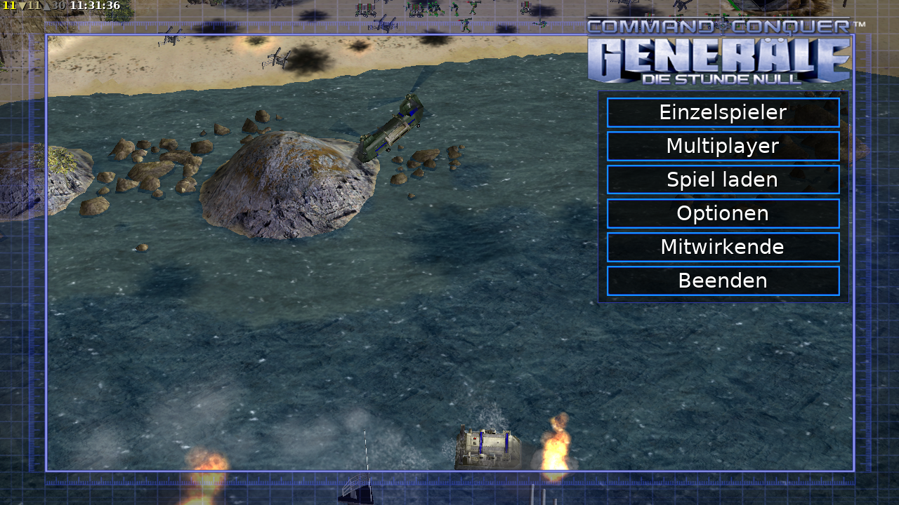
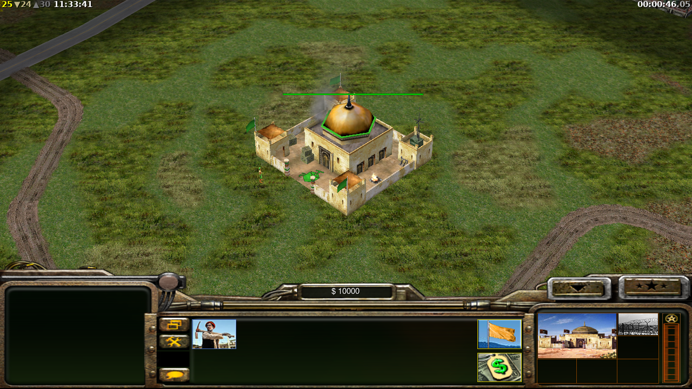

# C&C Generals – Die Stunde Null auf dem ODROID-N2+

*Command & Conquer Generals Zero Hour* läuft nativ auf den ODROID-N2+-Kiosks (DietPi, Debian 13, arm64) –
auf Deutsch, mit OpenGL auf der Mali-G52-GPU. Ein Gefecht läuft mit **24–25 fps bei 1280×720**
(die Spiellogik ist auf 30 fps begrenzt).

| Hauptmenü | Gefecht |
|---|---|
|  |  |

Die Kiosk-Anwendung (Diorama, Spiel, …) bleibt der Autostart. Generals wird bei Bedarf gestartet und gibt den
Bildschirm danach wieder an den Kiosk zurück – genau wie `quake3-demo` aus dem Repo *quake3-arena*.

Ausführlicher Bericht über Vorgehen, Sackgassen, Fehler und Messwerte: [docs/ERKENNTNISSE.md](docs/ERKENNTNISSE.md).

## Grundlage

- Spielcode: EAs GPL-Quellcode-Veröffentlichung, weiterentwickelt im Fork
  [bobtista/GeneralsGameCode](https://github.com/bobtista/GeneralsGameCode) (Commit `8c03683`), der statt DirectX 8
  über [bgfx](https://github.com/bkaradzic/bgfx) rendert und einen nativen Linux-Build mitbringt (SDL3, OpenAL, FFmpeg).
- Der Fork rendert unter Linux über Vulkan. Die Mali-G52 hat aber nur einen experimentellen Vulkan-1.0-Treiber
  (PanVK) – auch Mesa 26.2.6 reicht nicht (DXVK fehlen 21 Pflichtfunktionen). OpenGL 3.1 über Panfrost dagegen
  kann alles Nötige, inklusive der S3TC/DXT-Texturen des Spiels. Deshalb dieser OpenGL-Build.
- Die Spieldaten sind **nicht** enthalten: Man braucht eine eigene Kopie von Generals und Zero Hour
  (hier: die Steam-Versionen, deutsch).

## Patches

Die Patches in `patches/` werden der Reihe nach auf den Fork angewendet:

| Patch | Zweck |
|---|---|
| `00-gl-renderer.patch` | Neues Build-Ziel `GGC_BGFX_RENDERER=gl`: Shader als GLSL 1.40 (OpenGL 3.1), Standard-Renderer OpenGL |
| `01-profile-iquote.patch` | `debug/debug.h` des Spiels verdeckte die gleichnamige Datei von libstdc++ (GCC 14) |
| `02-stringex-wchar.patch` | Fehlendes `#include <wchar.h>` (`wcspbrk`, `wcsrchr`) |
| `03-arm-signed-char.patch` | `-fsigned-char` für den Spielcode: Generals erwartet vorzeichenbehaftetes `char` wie auf x86 |
| `04-prim-anim-return.patch` | `Set_Time()` ohne `return` – mit GCC auf ARM ein möglicher Absturz |
| `05-gnu-ld-link-group.patch` | Die Spielbibliotheken hängen ringförmig voneinander ab; GNU ld bekommt `--start-group`/`--end-group` |
| `06-bgfx-gl31-context.patch` | bgfx fordert OpenGL 3.1 an (Standard 2.1 schreibt die Shader auf GLSL 1.20 um, was scheitert) |
| `07-gl-texturegrad-rename.patch` | Der GLSL-Optimierer von bgfx erzeugt `textureGradARB`; wird beim Laden in `textureGrad` umbenannt |

## Installation auf einem Kiosk

Voraussetzungen auf dem PC: Git Bash, PuTTY (`plink`), Generals und Zero Hour in Steam installiert und das fertig
gebaute Spiel unter `dist/generalszh-arm64.tar.gz` (nicht im Repo, siehe *Bauen*).

```bash
KIOSK_PASSWORD=... KIOSK_HOSTKEY=SHA256:... tools/install-remote.sh
```

Das Skript kopiert die Spieldaten (~2,6 GB, ca. 8 Minuten, nur lesend aus den Steam-Ordnern) nach
`/opt/cnc-gamedata/{generals,zerohour}`, installiert das Spiel nach `/opt/generalszh` und den Starter. Beim zweiten
Lauf werden die Spieldaten übersprungen. Andere Pfade: `GENERALS_DIR`, `ZEROHOUR_DIR`, `KIOSK_HOST`.

## Spielen

Per SSH oder auf der Konsole (Strg+Alt+F2, als root anmelden):

```bash
generals-zh                      # startet das Spiel auf dem Fernseher, der Kiosk pausiert
systemctl stop generals-zh       # beendet es (oder im Spiel: Beenden) – der Kiosk kommt zurück
GENERALS_MODE=1920x1080 generals-zh   # andere Auflösung (Standard 1280x720)
```

Generals wird mit **Maus und Tastatur** gespielt. Das Hauptmenü erscheint, sobald die Maus bewegt wird.

## Leistung

Gemessen auf dem ODROID-N2+ (Mali-G52, Panfrost, GPU-Takt 800 MHz). Die GPU ist der Engpass, die CPU ist kaum
ausgelastet. Deshalb schaltet `device/Bgfx.ini` die Zusatzeffekte des Forks ab (4× MSAA, Schatten-Map,
Nachbearbeitung), und der Starter stellt das HDMI-Signal auf 1280×720 um (die Auflösung aus `Options.ini`
ignoriert der Fork; er nutzt immer die volle Bildschirmgröße).

| Szene | Einstellung | fps |
|---|---|---|
| Hauptmenü (Seeschlacht im Hintergrund) | 1920×1080, Standard-Effekte | 4 |
| Hauptmenü | 1920×1080, `Bgfx.ini` | 9 |
| Hauptmenü | 1280×720, `Bgfx.ini` | 11 |
| Gefecht, Spielbeginn | 1280×720, `Bgfx.ini` | 24–25 |

## Bauen

Gebaut wird direkt auf einem Kiosk (ca. 1–1,5 Stunden, 3 Kerne, 4 GB Auslagerungsdatei):

```bash
KIOSK_PASSWORD=... KIOSK_HOSTKEY=SHA256:... tools/build-remote.sh   # startet build/build-generals.sh im Hintergrund
# auf dem Gerät: tail -f /root/gen/build.log  (endet mit BUILD-DONE)
KIOSK_PASSWORD=... KIOSK_HOSTKEY=SHA256:... tools/fetch-dist.sh     # holt das Ergebnis nach dist/
```

Das Build-Skript installiert die Build-Pakete und lädt den Fork, SDL3, OpenAL, bgfx und FFmpeg aus dem Internet.
Danach kann man die Build-Pakete wieder entfernen (`apt-get purge` der Pakete, die nicht zur Kiosk-Grundausstattung
gehören) und `/root/gen` löschen; das installierte Spiel braucht nur Bibliotheken, die ein Chromium-Kiosk ohnehin hat.

## Bekannte Einschränkungen

- Im deutschen Einzelspieler-Menü heißt ein vom Fork neu hinzugefügter Knopf „MISSING: 'GUI:CustomMission'“
  (fehlender Text in den deutschen Sprachdateien).
- Kein Controller: Generals braucht eine Maus.
- Ton über HDMI ist noch nicht geprüft.
